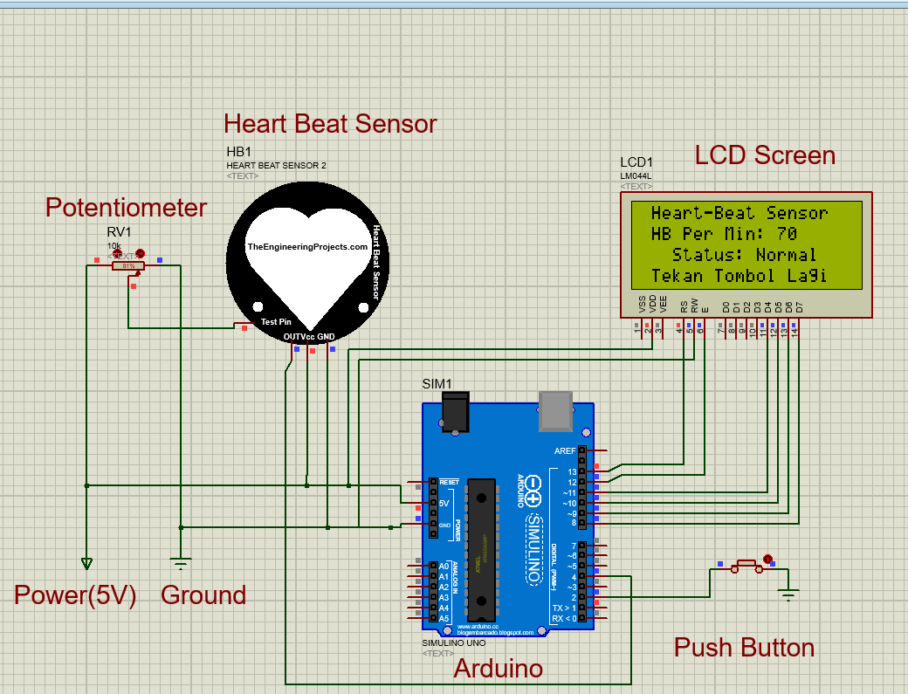
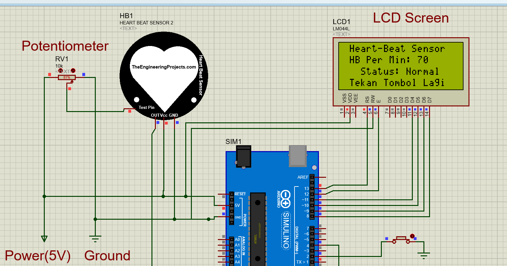
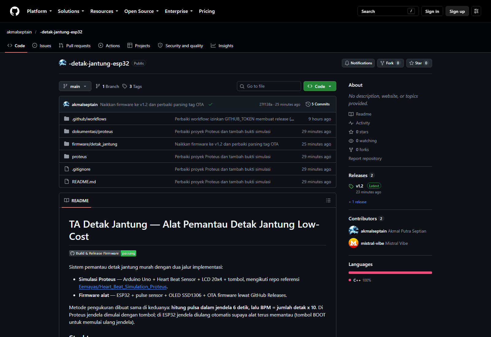
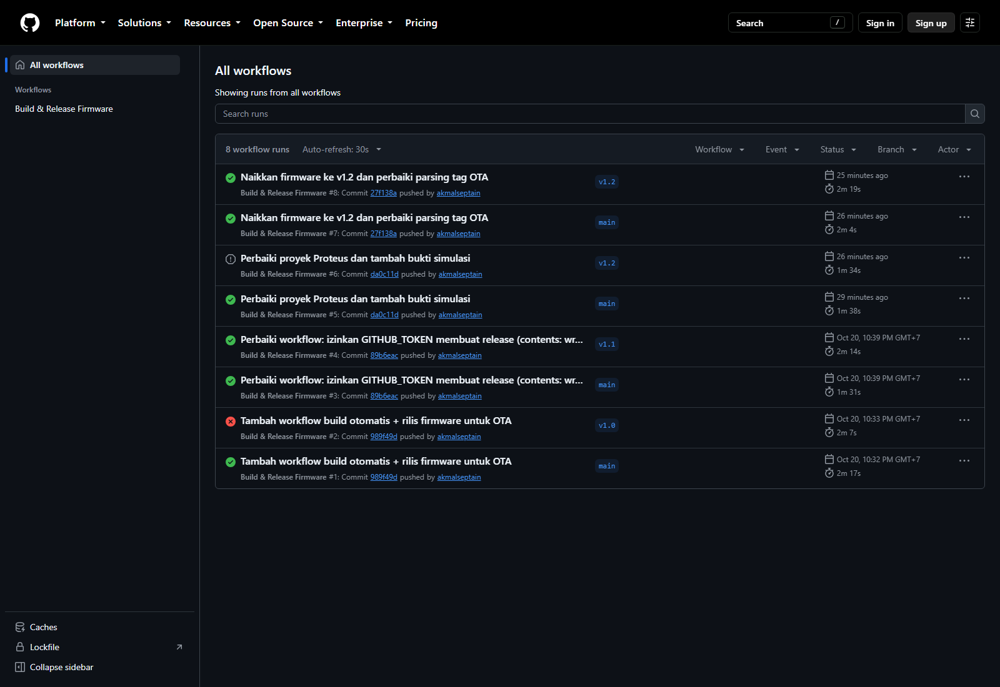
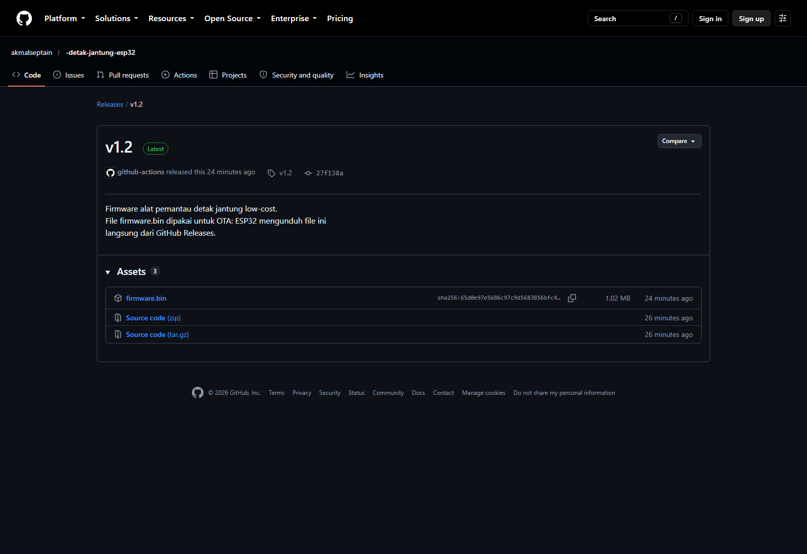
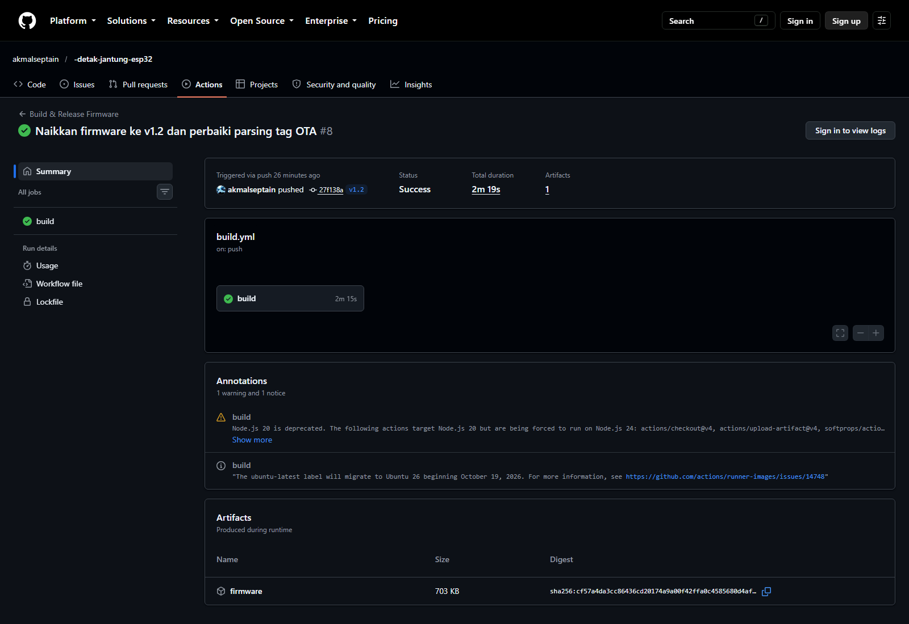

# TA Detak Jantung — Alat Pemantau Detak Jantung Low-Cost

[](https://github.com/akmalseptain/-detak-jantung-esp32/actions/workflows/build.yml)

Sistem pemantau detak jantung murah dengan dua jalur implementasi:

- **Simulasi Proteus** — Arduino Uno + Heart Beat Sensor + LCD 20x4 + tombol,
  mengikuti repo referensi
  [Eemayas/Heart_Beat_Simulation_Proteus](https://github.com/Eemayas/Heart_Beat_Simulation_Proteus).
- **Firmware alat** — ESP32 + pulse sensor + OLED SSD1306 + OTA firmware lewat
  GitHub Releases.

Metode pengukuran dibuat sama di keduanya: **hitung pulsa dalam jendela 6 detik,
lalu BPM = jumlah detak x 10**. Di Proteus jendela dimulai dengan tombol; di
ESP32 jendela diulang otomatis supaya alat terus memantau (tombol BOOT untuk
memulai ulang jendela).

## Struktur repo

```
proteus/
  detak_jantung.pdsprj                             -> proyek Proteus siap dibuka (sudah terisi HEX)
  Necessary library/                               -> HEX model sensor yang dipanggil proyek
  detak_jantung_proteus/
    detak_jantung_proteus.ino                      -> sketch simulasi (Arduino Uno)
    build/detak_jantung_proteus.ino.hex            -> hasil compile, siap dipakai
  libraries/
    Arduino Proteus Library/                       -> library Arduino untuk Proteus
    Heart Beat Sensor Library for Proteus/         -> model sensor detak + HEX-nya
    TimerOne-1.1.0.zip                             -> library TimerOne untuk Arduino IDE
  referensi/
    Heart_Rate Monitor.pdsprj                      -> proyek asli dari repo referensi (MIT)
firmware/detak_jantung/detak_jantung.ino           -> firmware utama (ESP32)
firmware/detak_jantung/diagram.json                -> rangkaian Wokwi (simulasi ESP32)
dokumentasi/proteus/simulasi.png                   -> bukti simulasi (LCD 70 BPM)
dokumentasi/proteus/wiring.png                     -> detail wiring yang dipakai
.github/workflows/build.yml                        -> build otomatis + rilis firmware
```

## 1. Simulasi Proteus

### Komponen

| Komponen | Keterangan |
|---|---|
| Arduino Uno (ATmega328P) | pengendali utama |
| Heart Beat Sensor (`HEART BEAT SENSOR`, library `HeartBeatSensorTEP`) | sumber pulsa detak |
| Potensiometer | mengatur laju detak pada model sensor |
| LCD 20x4 (LM044L) | penampil BPM dan status |
| Push button | mulai / ulang pengukuran |
| Virtual Terminal (opsional) | serial monitor 9600 baud |

### Wiring

| Dari | Ke |
|---|---|
| Heart Beat Sensor `OUT` | Arduino **D4** |
| Potensiometer (wiper/output) | input Heart Beat Sensor |
| Push button | **D2** dan **GND** (mode `INPUT_PULLUP`) |
| LCD `RS` / `E` | **D13** / **D12** |
| LCD `D4` / `D5` / `D6` / `D7` | **D11** / **D10** / **D9** / **D8** |
| LCD `RW` | GND |
| LCD `VSS`, `VEE` (kontras) | GND |
| Sensor, potensiometer, LCD `VDD`/`VCC` | 5V |
| Semua `GND` | GND |

Catatan: LCD memakai D13, jadi LED indikator detak tidak dipakai di simulasi
(berbeda dari firmware ESP32 yang memakai GPIO 2).

### Langkah menjalankan

Library Proteus **sudah dipasang** di komputer ini:

- Proteus 8 Professional: `C:\Program Files (x86)\Labcenter Electronics\Proteus 8 Professional\DATA\LIBRARY`
- Proteus 9 Professional: `C:\ProgramData\Labcenter Electronics\Proteus 9 Professional\Library`

Kalau proyek dipindah ke komputer lain, copy ulang library-nya:

1. **Install library Proteus**
   - Copy `ARDUINO2.LIB` + `ARDUINO2.IDX` ke folder `LIBRARY` Proteus.
   - Copy `HeartBeatSensorTEP.LIB` + `.IDX` + `.HEX` (dan `HeartBeatSensorTEP2.HEX`)
     ke folder `LIBRARY` Proteus. File `.HEX` harus tetap satu folder dengan `.LIB`.
   - Tutup lalu buka ulang Proteus agar library terdeteksi.
2. **Buka proyek**
   - Buka `proteus/detak_jantung.pdsprj` di Proteus 8/9.
   - Program Arduino sudah menunjuk ke
     `detak_jantung_proteus/build/detak_jantung_proteus.ino.hex` (path relatif
     terhadap folder `proteus/`, jadi tidak perlu diubah setelah repo di-clone).
   - Jalankan simulasi dengan tombol play.
3. **Kalau ingin mengubah kode**
   - Buka `detak_jantung_proteus.ino`, pilih board **Arduino Uno**.
   - *Sketch -> Export Compiled Binary*, lalu ganti **Program File** Arduino Uno
     di Proteus dengan `.hex` yang baru.
   - `TimerOne` dibutuhkan; install dari `proteus/libraries/TimerOne-1.1.0.zip`
     lewat *Sketch -> Include Library -> Add .ZIP Library*.

### Cara pakai di simulasi

1. Tekan tombol, tunggu 6 detik.
2. LCD menampilkan `HB Per Min` dan status `Normal` / `! DI LUAR NORMAL !`.
3. Serial monitor (9600 baud) menampilkan `HB Per Min: ...`.
4. Putar potensiometer untuk mengubah laju detak, lalu tekan tombol lagi.

### Bukti simulasi





Screenshot diambil dari `proteus/detak_jantung.pdsprj` yang ada di repo ini:
potensiometer 81%, tombol ditekan, lalu LCD menampilkan `HB Per Min: 70`
dengan `Status: Normal` (sesuai tabel skenario uji di bawah).

Proyek asli dari repo referensi tetap disimpan di
`proteus/referensi/Heart_Rate Monitor.pdsprj` (lisensi MIT, atribusi di
`proteus/referensi/LICENSE`).

### Skenario uji

Nilai mengikuti laporan repo referensi (potensiometer 1k, jendela 6 detik):

| Potensiometer | Perkiraan BPM |
|---|---|
| 4% | 10 |
| 25% | 20 |
| 48% | 30 |
| 81% | 70 |

Karena BPM dihitung `jumlah detak x 10`, resolusi alat adalah **10 BPM**.
Jumlah detak yang lebih banyak (potensiometer lebih besar) menghasilkan BPM
lebih tinggi.

## 2. Firmware ESP32

### Wiring hardware asli

| Komponen | Pin ESP32 |
|---|---|
| Pulse sensor (SIG) | GPIO 34 |
| Pulse sensor (VCC) | 3V3 |
| Pulse sensor (GND) | GND |
| OLED SDA | GPIO 21 |
| OLED SCL | GPIO 22 |
| LED indikator | GPIO 2 |
| Tombol mulai ulang | GPIO 0 (tombol BOOT) |

### Cara kerja pengukuran

1. Sinyal analog sensor dibaca di GPIO 34.
2. Ambang detak mengikuti nilai maksimum/minimum sinyal (adaptif), dengan
   jeda minimum 250 ms antar detak.
3. Setiap tepi naik dihitung sebagai satu detak.
4. Setelah 6 detik: `BPM = jumlah detak x 10`, lalu jendela baru dimulai.
5. Hasil tampil di OLED dan serial 115200 baud.

### Simulasi Wokwi

`diagram.json` mengubungkan GPIO 25 (pembangkit pulsa `SIM_BPM`) ke GPIO 34.
Set `MODE_SIMULASI = true` dan atur `SIM_BPM` bila perlu. Untuk hardware asli,
set `MODE_SIMULASI = false`.

## 3. Build & rilis otomatis (GitHub Actions)

- Setiap push ke `main`: firmware ESP32 dikompilasi otomatis (arduino-cli).
- Setiap tag baru `v*` (contoh: `git tag v1.2 && git push --tags`):
  GitHub Actions membuat **Release** berisi `firmware.bin`.

Bukti pipeline (screenshot asli + penjelasan) ada di
[`dokumentasi/github/`](dokumentasi/github/README.md):

| Repository | Actions |
|---|---|
|  |  |

| Release v1.2 | Log build (run #8) |
|---|---|
|  |  |

## 4. Cara kerja OTA di perangkat

1. Firmware memanggil GitHub API `releases/latest` (sekali per 6 jam).
2. Bila tag versi lebih baru dari `FIRMWARE_VERSION`, aset `firmware.bin`
   diunduh via HTTPS.
3. `Update.h` menulis firmware baru ke partisi OTA; jika gagal, firmware
   lama dipertahankan (rollback otomatis ESP32).
4. Perangkat reboot menjalankan versi baru — tanpa kabel USB.

## 5. Catatan

- `klien.setInsecure()` di kode OTA sementara; sebelum sidang ganti dengan
  sertifikat GitHub yang disematkan (lebih aman).
- Isi `WIFI_SSID`, `WIFI_PASS`, dan `OTA_REPO` sebelum flash ke hardware.
- Naikkan `FIRMWARE_VERSION` setiap kali merilis firmware baru.
- Simulasi memakai model sensor ideal; hasil BPM pada hardware asli perlu
  kalibrasi dengan alat pembanding.
- Repo referensi: <https://github.com/Eemayas/Heart_Beat_Simulation_Proteus>
  (MIT). Library Proteus dan proyek contoh berasal dari repo tersebut dan
  disertakan dengan atribusi.
